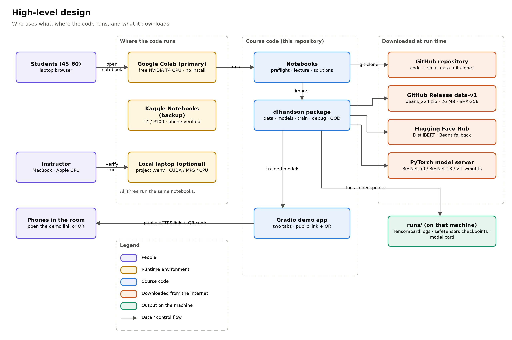
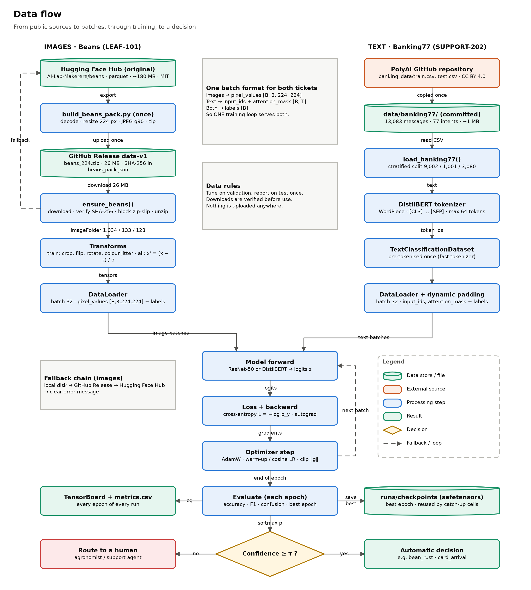
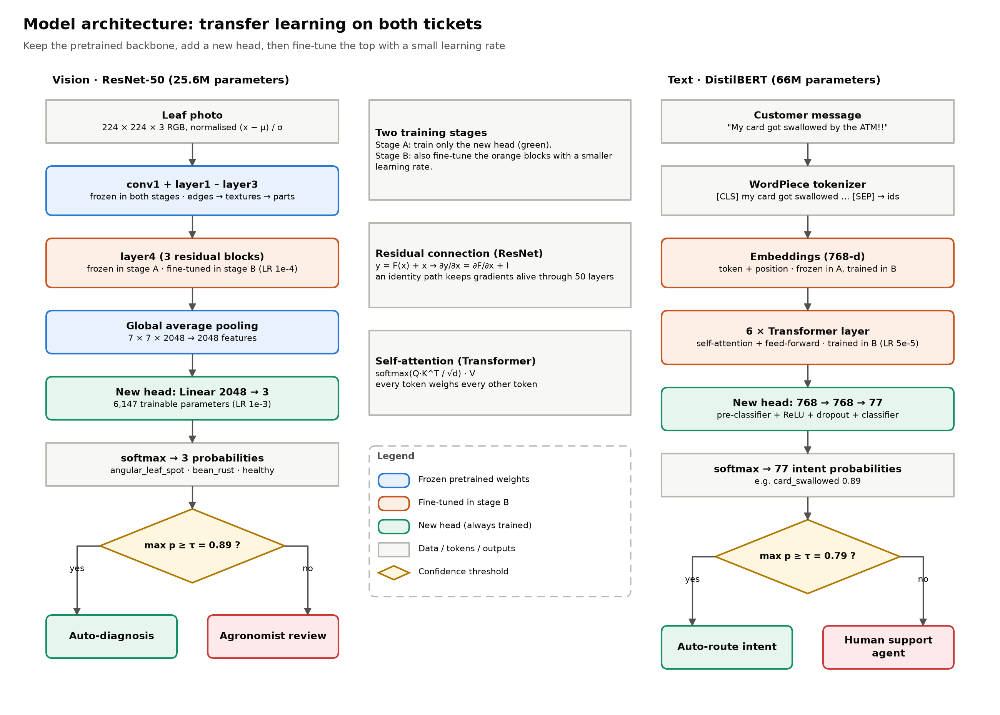
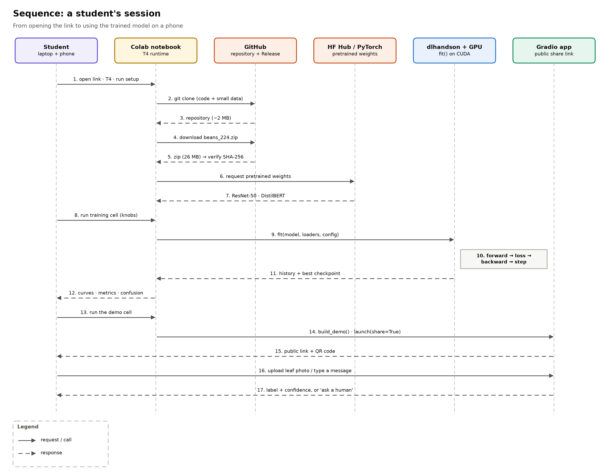
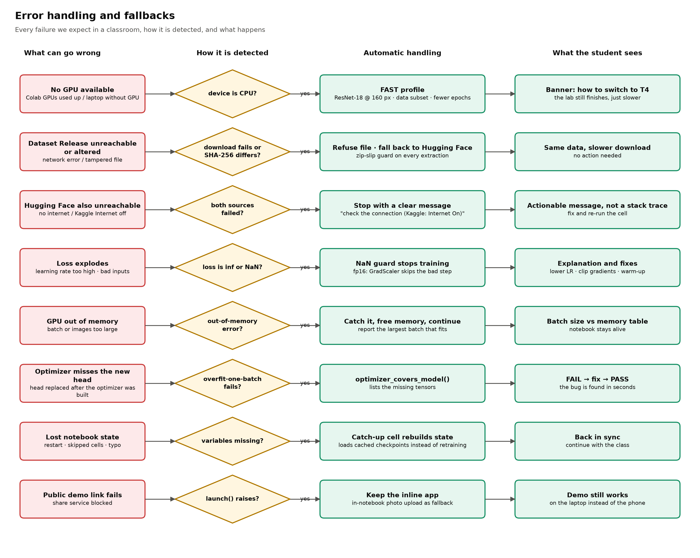
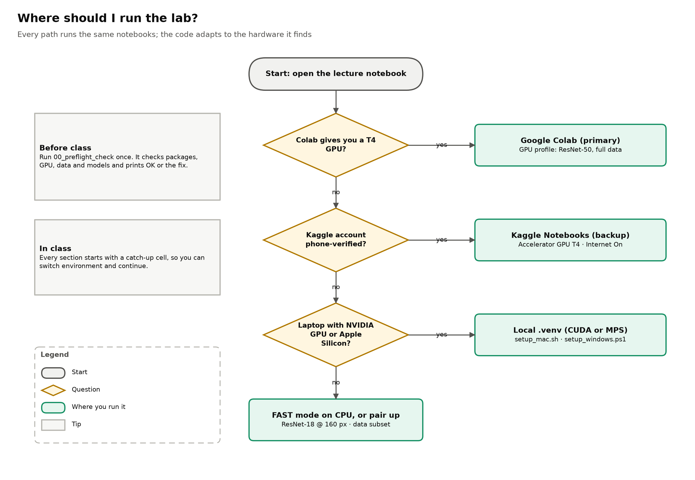
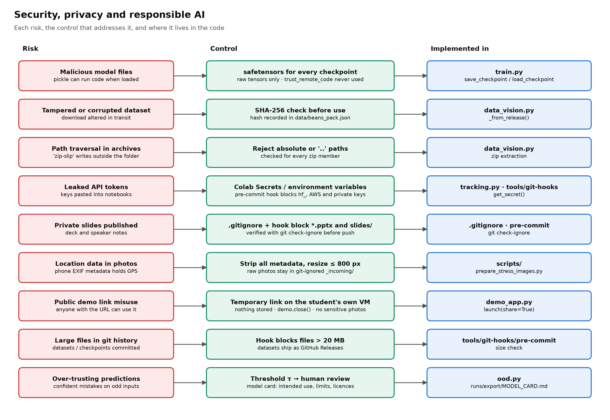
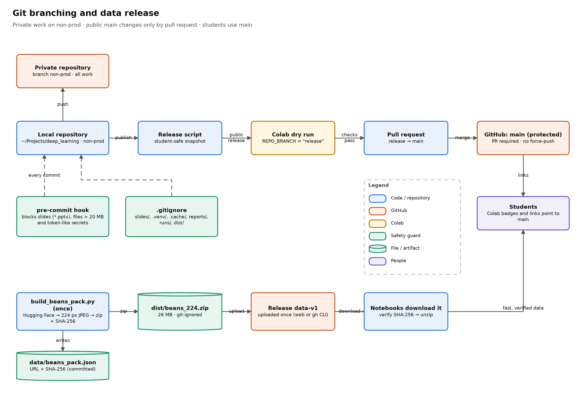
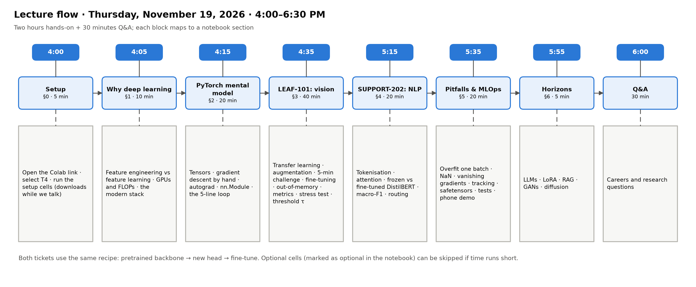

# Technical Design Document — Deep Learning Hands-On Lecture Kit

| | |
|---|---|
| Project | `deep-learning-handson-lecture` (local folder `~/Projects/deep_learning`) |
| Owner | Dr. Sushanth Manakhari |
| Context | Guest lecture, The Roux Institute at Northeastern University, Nov 19, 2026 (host: Dr. Umesh Hodeghatta Rao) |
| Status | v1.0 — verified end to end on a free Colab T4 (Python 3.13) and on macOS (Apple M1 Pro GPU, Python 3.15.2) |
| Repository | https://github.com/Sushanth-Manakhari/deep-learning-handson-lecture (students use `main`) |

---

## 1. Purpose and scope

Deliver a **2-hour, hands-on, industry-oriented** deep-learning session for 45–60 graduate students
(CS / Data Science / AI-ML) with a mix of NLP and computer-vision interests, using only **free compute**
(Google Colab, Kaggle, or their own laptops). The kit must teach by running code — "show the math in
action" — and must never leave a student stranded.

**In scope:** two end-to-end transfer-learning projects (images, text), PyTorch fundamentals, debugging,
MLOps basics, a phone-accessible demo app, documentation, diagrams and a slide deck.
**Out of scope:** paid cloud (AWS/Azure/GCP), training from scratch at scale, production deployment,
LLM fine-tuning (covered conceptually in "Horizons").

## 2. Requirements

### 2.1 Functional
| ID | Requirement | Where |
|---|---|---|
| FR-1 | Demonstrate tensors, autograd (checked against hand-derived gradients), `nn.Module`, DataLoader, the training loop | Notebook §2 |
| FR-2 | Fine-tune a pretrained CNN on a small real image dataset: freeze → new head → fine-tune top block | §3, `models.py` |
| FR-3 | Fine-tune a pretrained Transformer on a real text-classification task; compare frozen vs full fine-tune | §4 |
| FR-4 | Let students change hyperparameters safely and see the effect (challenge) | §3.7, notebook 02 |
| FR-5 | Teach debugging: overfit one batch, optimizer bug, exploding/vanishing gradients, out-of-memory | §5, `debug_tools.py` |
| FR-6 | Show data augmentation, evaluation metrics, out-of-distribution behaviour and human-in-the-loop thresholds | §3.6, §3.10–3.12, `ood.py` |
| FR-7 | Let anyone try the models from a phone (upload from gallery / camera, or type text) | §5.7, `demo_app.py` |
| FR-8 | Show production habits: experiment tracking, safe checkpoints, model card, tests, CLI | §5.4–5.6, `scripts/` |

### 2.2 Non-functional
| ID | Requirement | Design response |
|---|---|---|
| NFR-1 | Zero install for students | Colab notebook clones the repo and installs only missing extras (`gradio`, `qrcode`, `safetensors`) |
| NFR-2 | Whole lab fits the 2-hour slot | T4 dry run: a full walk-through at reading pace took 78 min of the 120; compute per epoch 6–17 s |
| NFR-3 | "Don't Panic": runs top to bottom; recoverable from any point | Idempotent 🛟 catch-up cells, cached checkpoints, automated smoke execution of every notebook |
| NFR-4 | No 10-minute dataset waits on university Wi-Fi | Pre-resized 26 MB pack on GitHub Releases (SHA-256 verified), text data committed (1 MB) |
| NFR-5 | Works on any hardware | Device auto-selection CUDA → MPS → CPU; hardware profiles shrink work on CPU |
| NFR-6 | 45–60 simultaneous users | Each student runs on their own Colab VM; nothing shared server-side |
| NFR-7 | Reproducible | Fixed seeds, configs logged per run, pinned minimums, `pip freeze` recorded by setup |
| NFR-8 | Secure and privacy-aware | safetensors, checksum, zip-slip guard, secret scanning hook, EXIF stripping, expiring demo link (§11) |
| NFR-9 | Instructor installs stay project-local | `.venv/` and all caches (`pip`, Hugging Face, torch, matplotlib) inside the project folder |

## 3. Constraints and assumptions
- Students: Python + basic ML; laptops may be Mac or Windows; some will not get a free GPU.
- Colab free tier: T4 (16 GB) when available, no guarantees, session limits; Kaggle needs phone verification.
- Instructor machine: macOS on Apple Silicon, Homebrew Python (3.15.2 at time of writing; no version hard-coded).
- Datasets must be small, real-world, permissively licensed (§5).

## 4. Architecture overview



| Component | Responsibility | Key files |
|---|---|---|
| Notebooks | Teaching narrative, math, interactive cells | `notebooks/src/*.py` (sources) → `notebooks/*.ipynb` |
| `dlhandson` package | Reusable, tested implementation of everything the notebooks do | `src/dlhandson/` |
| Data layer | Download with fallbacks, integrity check, transforms, loaders | `data_vision.py`, `data_text.py` |
| Model layer | Pretrained backbones, freezing, heads, discriminative LR | `models.py` |
| Training engine | Loop, AMP, clipping, schedules, NaN guard, checkpoints | `train.py` |
| Diagnostics | Overfit-one-batch, optimizer check, gradient demos, OOM search | `debug_tools.py` |
| Reliability | Confidence, entropy, selective prediction, stress tests | `ood.py` |
| Tracking | TensorBoard + CSV (+ optional W&B) | `tracking.py` |
| Serving demo | Gradio two-tab app, share link, QR code | `demo_app.py` |
| Recovery | 🛟 catch-up state rebuilders | `catchup.py` |
| Tooling | Setup, verification, data pack, photo cleaning, CLIs, notebook build/run | `scripts/` |
| Quality gates | Unit tests, pre-commit hook | `tests/`, `tools/git-hooks/pre-commit` |

**Module dependency rule:** notebooks → `dlhandson` → (PyTorch, torchvision, Transformers). The package
never imports notebook code; scripts import the package. One forward function (`forward_logits`) and
dict batches (`pixel_values` / `input_ids` + `labels`) let **one training loop** serve both modalities.

## 5. Data design



| Dataset | Use | Licence | Size / splits | Source | Delivery |
|---|---|---|---|---|---|
| **Beans** (Makerere University AI Lab) | LEAF-101 vision | MIT | 1,295 field photos: 1,034 / 133 / 128; classes `angular_leaf_spot`, `bean_rust`, `healthy` | https://huggingface.co/datasets/AI-Lab-Makerere/beans (orig. https://github.com/AI-Lab-Makerere/ibean/) | GitHub Release `data-v1/beans_224.zip` (26 MB, SHA-256 `494ec845…`) → fallback Hub parquet (~180 MB) |
| **Banking77** (PolyAI) | SUPPORT-202 text | CC BY 4.0 | 13,083 messages: 10,003 train (→ 9,002 train + 1,001 stratified validation) / 3,080 test; 77 intents | https://github.com/PolyAI-LDN/task-specific-datasets · paper https://arxiv.org/abs/2003.04807 | Committed `data/banking77/` (1 MB); re-download from GitHub if missing |
| scikit-image samples (coffee cup, cat) | OOD stress test | CC0 | 2 images | https://github.com/scikit-image/scikit-image/tree/v0.25.2/skimage/data | Committed `data/stress_test/non_leaf/` |
| Instructor photos | OOD stress test | Instructor's own | 3–4 images | Phone → `_incoming/` (ignored) → EXIF stripped | Committed `data/stress_test/instructor_photos/` |
| Corruptions + synthetic | OOD stress test | n/a | generated at run time | `ood.py` (blur, dark, glare, JPEG, crop; noise, flat green) | Not stored |
| MedMNIST, SMS Spam (take-home) | Extensions | CC BY 4.0 | — | https://medmnist.com/ · https://archive.ics.uci.edu/dataset/228/sms+spam+collection | Not downloaded in class |

**Beans pipeline.** `build_beans_pack.py` (instructor, once): Hub parquet → decode → 224×224 bicubic →
JPEG q90 → ImageFolder layout → zip (stored) → SHA-256 → `data/beans_pack.json`. At run time
`ensure_beans()` tries local disk → Release (verify checksum, block zip-slip) → Hub → raises a clear
error. Pre-resizing cuts download 7× and JPEG decode time per epoch.

**Pre-processing.** Eval: resize → center-crop 224 → float [0,1] → normalise with ImageNet statistics
$x' = (x-\mu)/\sigma$. Train augmentation: random resized crop (scale 0.6–1), horizontal + vertical
flips, rotation ±20°, colour jitter (brightness/contrast 0.3, saturation 0.2, **hue only 0.02** —
lesion colour is label-bearing).

**Text pipeline.** WordPiece tokenisation (DistilBERT, vocab 30,522), truncation at 64 tokens
(95th percentile = 37 tokens; 0.3% truncated), pre-tokenised once, **dynamic padding** per batch
(attention cost ∝ $n^2$).

## 6. Model design



Transfer learning as $f(x)=h_\phi(g_\theta(x))$: keep the pretrained backbone $g_\theta$, learn a new
head $h_\phi$, then optionally fine-tune the top of $g_\theta$ with a smaller learning rate.

| | Vision (LEAF-101) | Text (SUPPORT-202) |
|---|---|---|
| Backbone | ResNet-50, ImageNet-1K V2 (25.6M params) — https://download.pytorch.org/models/resnet50-11ad3fa6.pth | DistilBERT base uncased (66M) — https://huggingface.co/distilbert/distilbert-base-uncased |
| CPU FAST mode | ResNet-18 (11.7M) @160 px, 450 train images, 3 epochs | 2,000 messages, 1 epoch, max length 48 |
| Head | Linear 2048 → 3 (6,147 params) | pre-classifier 768→768 + Linear 768 → 77 |
| Stage A | Frozen backbone, head only: AdamW lr 1e-3, wd 1e-4, batch 32, 5 epochs | Frozen encoder, head only: AdamW 1e-3, 2 epochs |
| Stage B | Unfreeze `layer4` (+14.97M params), **discriminative LR** head 1e-3 / backbone 1e-4, cosine decay, 4 epochs | Full fine-tune: AdamW **5e-5**, wd 0.01, batch 32, 4 epochs, 10% linear warm-up then linear decay, clip ‖g‖≤1 |
| Precision | fp16 autocast + GradScaler on CUDA; fp32 on MPS/CPU | same |
| Alternative | ViT-B/16 (86.6M, https://download.pytorch.org/models/vit_b_16-c867db91.pth) — instructor demo, 2-line swap | HF Trainer mentioned as the high-level alternative |
| Apple GPU note | — | `attn_implementation="eager"` on MPS (fused SDPA cannot apply dropout while training on MPS) |

**Rationale.** ResNet-50 is the classic, fast, well-understood CNN; its residual connections
($y=F(x)+x$) are themselves a lecture point. DistilBERT is a production-grade small Transformer that
fine-tunes in minutes on a T4 and shares the architecture family of LLMs. Text uses full fine-tuning
because 77 near-synonymous intents are far from the pretraining objective (frozen: ~52% validation).

**Hyperparameter rationale.** Head-only LR 1e-3 (random head, large steps); backbone LR ×0.1 (avoid
catastrophic forgetting); text LR 5e-5 with warm-up (Adam statistics unreliable in the first steps);
batch 32 balances T4 memory, steps per epoch and gradient noise. The verified Mac run showed text at
batch 64 × 3 epochs still improving (85.2% test) → increased to batch 32 × 4 epochs.

## 7. Training pipeline



`fit()` = for each epoch: `train_one_epoch` (zero_grad → forward → cross-entropy → NaN check → backward
(scaled) → unscale → measure/clip ‖g‖ → step → scheduler) → `evaluate` (no_grad, eval mode) → log →
save best checkpoint (safetensors). Cross-entropy $L=-\log p_y$, $\partial L/\partial z_k=p_k-\mathbb 1[k=y]$.
Optimisers documented with update rules in `train.py`. The gradient norm returned by
`clip_grad_norm_` doubles as a health metric logged every epoch.

## 8. Evaluation

| Metric | Definition | Why |
|---|---|---|
| Accuracy | correct / total | Beans is class-balanced |
| Precision / recall / F1 (per class) | $P=\frac{TP}{TP+FP}$, $R=\frac{TP}{TP+FN}$, $F_1=\frac{2PR}{P+R}$ | Recall on diseased leaves matters to farmers |
| Macro-F1 | mean of per-class F1 | 77 intents count equally |
| Confusion matrix / most-confused pairs | — | Error analysis; reveals ambiguous labels |
| Selective prediction | coverage and accuracy vs threshold τ on max-softmax | Business target, e.g. 98% accuracy on automatic decisions |
| Stress test | predictions + confidence on corrupted / non-leaf / synthetic images | Demonstrates confident OOD errors |

Thresholds are chosen on **validation** and reported on **test** (tested once).

### 8.1 Measured results (Colab T4 and instructor Mac)

Measured with fixed seeds on Nov 5, 2026, on a **free Google Colab Tesla T4** (classroom conditions: Python 3.13,
PyTorch 2.11, Transformers 5.22) and on the instructor's **MacBook Pro M1 Pro** (Apple GPU via MPS: Python 3.15.2,
PyTorch 2.15, Transformers 5.22). The T4 run is saved with all outputs in `notebooks/01_lecture_handson_INSTRUCTOR.ipynb`.

| Ticket | Step | Colab T4 | MacBook M1 Pro |
|---|---|---|---|
| 🌱 LEAF-101 | Hand-crafted colour/edge features + logistic regression (validation) | 70.7% | 71.4% |
| 🌱 LEAF-101 | ResNet-50 frozen + new head, no augmentation (validation) | 88.7% | 88.7% |
| 🌱 LEAF-101 | Same + data augmentation, 5 epochs (validation) | 87.2% | 85.7% |
| 🌱 LEAF-101 | + fine-tune `layer4`, discriminative LR (validation / **test**) | 91.0% / **90.6%** | 93.2% / **91.4%** |
| 🌱 LEAF-101 | Confidence threshold τ: share decided automatically, accuracy on those | τ 0.92 · 68% · 98.9% | τ 0.89 · 75% |
| 🌱 LEAF-101 | Stress test (corrupted / non-leaf / synthetic images sent to a human) | 14 of 15 | 14 of 15 |
| 🌱 LEAF-101 | ViT-B/16, head only (instructor demo, validation) | 88.0% | needs CUDA |
| 💬 SUPPORT-202 | DistilBERT, frozen encoder (validation) | 55.5% | 58.7% |
| 💬 SUPPORT-202 | DistilBERT, full fine-tune (validation / **test** · macro-F1) | 91.2% / **92.1%** · 0.921 | 91.3% / **91.8%** · 0.917 |
| ⏱️ Compute | Matrix-multiply speed (float32 · float16) | 3.8 · 21.7 TFLOP/s | 4.0 TFLOP/s |
| ⏱️ Compute | Epoch time: ResNet-50 head · DistilBERT fine-tune | 6–11 s · 17 s | 7–13 s · 51 s |
| ⏱️ Compute | Out-of-memory demo (full fine-tune, 224 px) | 7.6 / 10.5 / 13.5 GB at batch 32 / 64 / 128; batch 256 caught | needs CUDA |

Debugging demos behave identically on both machines: overfit-one-batch ✅, planted optimizer bug detected, lr 0.1 → NaN
(fixed by gradient clipping), sigmoid first-layer gradient ≈ 10⁻¹⁸ vs ReLU/residual ≈ 10⁻¹, the exported 94 MB
safetensors checkpoint reloads with identical predictions, and all 19 tests pass inside Colab.

## 9. Error handling and resilience



| Failure | Detection | Handling |
|---|---|---|
| No GPU | `get_device()` → CPU | Hardware profile "cpu": smaller model/data; banner with how to enable T4 |
| GitHub Release unavailable / tampered | download exception / SHA-256 mismatch | Refuse file; fall back to Hugging Face Hub; clear error if both fail |
| Malicious zip paths | absolute or `..` members | Abort extraction (zip-slip guard) |
| Loss becomes inf/NaN | `torch.isfinite(loss)` each step | `NonFiniteLossError` → `fit()` stops cleanly, prints causes and fixes, `history.diverged=True` |
| fp16 gradient overflow | GradScaler | Step skipped, scale reduced automatically |
| CUDA out of memory | `torch.OutOfMemoryError` / "out of memory" | Caught in `try_batch_size`; memory freed; notebook continues |
| Stale optimizer after head swap | `optimizer_covers_model()` | Lists missing parameters; overfit test fails loudly |
| Lost notebook state / restart | missing variables | 🛟 cells rebuild state; checkpoints cached in `runs/checkpoints/` |
| Interactive cells in automated runs | `DLH_HEADLESS=1` | Upload, TensorBoard and public link skip themselves |
| Gradio share link fails | exception in `launch()` | Inline app remains; in-notebook upload fallback |
| Unsupported op on Apple GPU | NotImplementedError | `PYTORCH_ENABLE_MPS_FALLBACK=1` in verification; eager attention for DistilBERT |
| HEIC photos | PIL cannot open | `sips` (macOS) or `pillow-heif` conversion |

## 10. Environments and compatibility



| Environment | Accelerator | Python | Status |
|---|---|---|---|
| Google Colab (free) | NVIDIA T4 16 GB (when available) | 3.13 (Colab default, Nov 2026) | ✅ verified end to end (dry run, Nov 5) |
| Kaggle Notebooks | T4 / P100 | Kaggle default | Backup (phone verification + Internet on) |
| macOS, Apple Silicon | MPS | 3.15.2 (Homebrew) | ✅ verified end to end |
| Windows / Linux + NVIDIA | CUDA | 3.10+ | Supported (user installs CUDA PyTorch build) |
| Any CPU | — | 3.10+ | FAST mode; ✅ smoke-verified on Python 3.13 and 3.15 |

Python 3.15 note: all 169 resolved packages have macOS arm64 wheels except PyYAML (compiled from
source; requires Xcode Command Line Tools — checked by `setup_mac.sh`). `scikit-image` was removed as a
dependency (unused; no 3.15 wheel).

## 11. Security, privacy and responsible AI



| Threat / concern | Control |
|---|---|
| Arbitrary code execution from model files | **safetensors** for all checkpoints; no `torch.load` of pickles; `trust_remote_code` never used |
| Tampered or corrupted downloads | SHA-256 verification of the dataset pack; HTTPS-only sources |
| Path traversal in archives | zip-slip guard |
| Leaked secrets | Tokens only via env vars / Colab Secrets (`get_secret`); pre-commit hook blocks `hf_…`, AWS keys, private keys, W&B keys |
| Private slides leaking | `.gitignore` (`slides/`, `*.pptx`, …) + pre-commit hook block + `git ls-files` check before push |
| Location data in photos | `prepare_stress_images.py` drops all EXIF (GPS); raw photos in git-ignored `_incoming/` |
| Public demo link | Gradio share URL is temporary (auto-expiry), runs on the student's own VM, no storage; `demo.close()` |
| Large binaries in history | hook blocks files > 20 MB; datasets via Releases |
| Supply chain | Well-known packages only; minimum versions; installed set recorded (`reports/pip_freeze.txt`) |
| Responsible AI | Model card (intended use, limits), human review below τ, licence attribution, bias notes (single region / one dialect of banking English), medical-use disclaimer in take-home B1 |

## 12. Repository structure and tooling

```
src/dlhandson/      package (15 modules) · tests/ (19 tests) · notebooks/src/ (jupytext sources)
notebooks/          00_preflight_check · 01_lecture_handson · 02_challenge_solutions (.ipynb, generated)
scripts/            setup_mac.sh · setup_windows.ps1 · verify.py · run_notebooks.py · build_notebooks.py
                    build_beans_pack.py · prepare_stress_images.py · train_vision.py · train_text.py
data/               banking77/ · stress_test/ · beans_pack.json   (beans/ is downloaded, ignored)
docs/               this document · README companions · diagrams/ (draw.io + PNG)
tools/git-hooks/    pre-commit
```
Notebook sources are percent-format Python (reviewable diffs); `build_notebooks.py` generates the
`.ipynb` files with Colab metadata (T4 by default) and an "Open in Colab" badge.

## 13. Testing and verification

| Level | What | How | Status |
|---|---|---|---|
| Unit | data shapes, dynamic padding, freezing counts, discriminative LR, overfit-one-batch, stale-optimizer detection, vanishing/exploding behaviour, NaN guard, selective-prediction maths | `pytest` (smoke mode, CPU, ~15 s) | ✅ 19/19 |
| Notebook smoke | all three notebooks top to bottom, tiny models, no downloads | `DLH_SMOKE=1 DLH_HEADLESS=1 scripts/run_notebooks.py` | ✅ Python 3.13 & 3.15 |
| Real end-to-end | real data + pretrained weights on the instructor's GPU, report with metrics and timings | `bash scripts/setup_mac.sh --verify` → `reports/verify_report.md` | ✅ |
| Classroom rehearsal | Colab T4, GitHub Release, OOM + ViT demos, phone app | instructor dry-run checklist | ✅ all demos, public phone link created |

## 14. Git workflow and release



Development happens on a private branch. A release script publishes a student-safe snapshot to a `release`
branch of this repository; it is dry-run on Colab and merged into `main` by pull request, so `main` only ever
changes through review. Instructor-only material (run-sheet, e-mails, setup notes, slides) is never published.
The dataset pack is published once as Release `data-v1`. Commits use the GitHub no-reply e-mail.

## 15. Lecture integration



| Time | Notebook section | Deep-learning concepts |
|---|---|---|
| 4:00 | 0–1 | GPUs, FLOPs, the modern stack, feature engineering vs feature learning |
| 4:15 | 2 | tensors, broadcasting, gradient descent & stability ($\eta<2/\lambda_{max}$), autograd, `nn.Module`, cross-entropy, training loop |
| 4:35 | 3 | transfer learning, residual connections, normalisation, augmentation, optimisers, batch size vs memory, fine-tuning, metrics, OOD, selective prediction, ViT |
| 5:15 | 4 | tokenisation, attention, freeze vs fine-tune, warm-up, clipping, macro-F1 |
| 5:35 | 5 | debugging checklist, exploding/vanishing gradients, tracking, safetensors, model cards, tests, serving |
| 5:55 | 6 | LLMs, LoRA, RAG, GANs, diffusion |

## 16. Risks and mitigations

| Risk | Likelihood | Impact | Mitigation |
|---|---|---|---|
| Colab GPUs exhausted at 4 PM | Medium | Medium | FAST mode, Kaggle backup, pairing, instructor projection |
| Notebook opened on a branch without code | Low | Medium | Setup cell verifies the clone's branch and contents, re-clones, or stops with the fix |
| Campus Wi-Fi saturation | Medium | High | 26 MB pack, pre-run instructor notebook, executed copy on GitHub |
| Library API changes before Nov 19 | Low | Medium | Colab dry run ~1 week before; minimum versions; smoke tests |
| Overrunning time | Medium | Medium | Run-sheet "skip" column; optional ⏩ cells |
| Students without laptops | Low | Low | Phone demo via QR; pairing |

## 17. Future work
Model calibration (temperature scaling) in the notebook; an explicit "not a leaf" class; ONNX export
and a FastAPI endpoint; LoRA fine-tuning of a small LLM as a follow-up lab; GitHub Actions running the
smoke tests on every pull request.

## Appendix A — Pretrained models

| Model | Params | Download | Licence | Docs / paper |
|---|---|---|---|---|
| ResNet-50 IMAGENET1K_V2 | 25.6M | ~98 MB · https://download.pytorch.org/models/resnet50-11ad3fa6.pth | BSD-3-Clause (torchvision) | https://docs.pytorch.org/vision/stable/models/generated/torchvision.models.resnet50.html · https://arxiv.org/abs/1512.03385 |
| ResNet-18 IMAGENET1K_V1 | 11.7M | ~45 MB · https://download.pytorch.org/models/resnet18-f37072fd.pth | BSD-3-Clause | https://docs.pytorch.org/vision/stable/models/generated/torchvision.models.resnet18.html |
| ViT-B/16 IMAGENET1K_V1 | 86.6M | ~330 MB · https://download.pytorch.org/models/vit_b_16-c867db91.pth | BSD-3-Clause | https://docs.pytorch.org/vision/stable/models/generated/torchvision.models.vit_b_16.html · https://arxiv.org/abs/2010.11929 |
| DistilBERT base uncased | 66M | ~268 MB (model.safetensors) | Apache-2.0 | https://huggingface.co/distilbert/distilbert-base-uncased · https://arxiv.org/abs/1910.01108 |

## Appendix B — References
ResNet https://arxiv.org/abs/1512.03385 · He initialisation https://arxiv.org/abs/1502.01852 ·
Transformer https://arxiv.org/abs/1706.03762 · BERT https://arxiv.org/abs/1810.04805 ·
DistilBERT https://arxiv.org/abs/1910.01108 · ViT https://arxiv.org/abs/2010.11929 ·
AdamW https://arxiv.org/abs/1711.05101 · Mixed precision https://arxiv.org/abs/1710.03740 ·
MSP OOD baseline https://arxiv.org/abs/1610.02136 · Calibration https://arxiv.org/abs/1706.04599 ·
Model cards https://arxiv.org/abs/1810.03993 · Banking77 https://arxiv.org/abs/2003.04807 ·
LoRA https://arxiv.org/abs/2106.09685 · GANs https://arxiv.org/abs/1406.2661 · DDPM https://arxiv.org/abs/2006.11239

## Appendix C — Glossary
**Backbone** pretrained feature extractor · **Head** task-specific output layer · **Freeze** stop updating
parameters (`requires_grad=False`) · **Fine-tune** continue training pretrained weights with a small LR ·
**AMP** automatic mixed precision · **MPS** Apple's GPU backend for PyTorch · **OOD** out-of-distribution
input · **MSP** maximum softmax probability · **Selective prediction** abstain (route to a human) below a
confidence threshold · **safetensors** pickle-free tensor file format · **Smoke test** fast run with tiny
models that checks the plumbing, not the accuracy.
